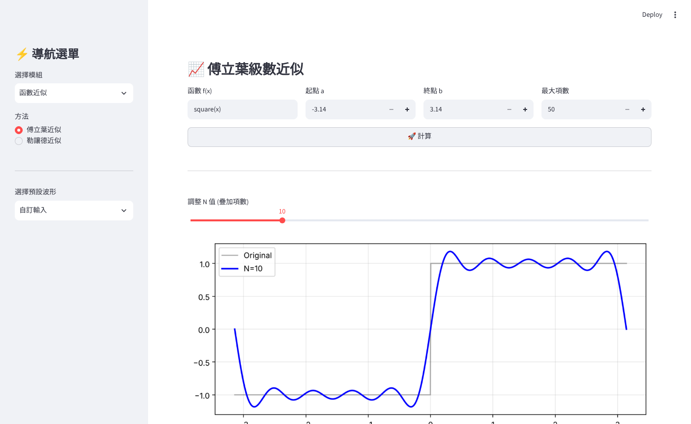
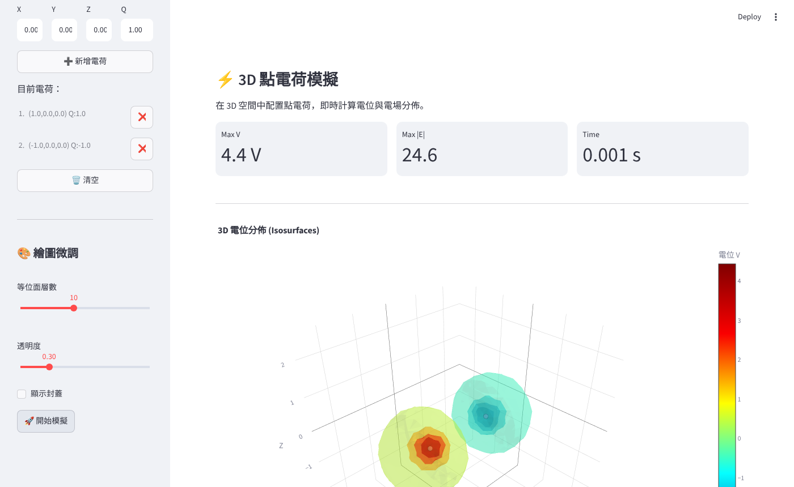

# Electromagnetics Visualization Hub · 電磁學生成小教室

**English** | [繁體中文](README.zh-TW.md)

An interactive [Streamlit](https://streamlit.io/) teaching app for undergraduate electromagnetics. Type a function or a set of boundary conditions and see the series approximation, the electric potential and the electric field update in the browser. The topics follow the series-expansion and Laplace-equation material of an introductory electrodynamics course (Griffiths, chapters 2–3): Fourier and Legendre series, the 2D and 3D Laplace equation, and the potential and field of point charges and continuous charge distributions.

The whole app is a single file, `app.py`. Its interface is in Traditional Chinese; this README gives the Chinese label next to each English description so you can find every control.



## Contents

- [Who it is for](#who-it-is-for)
- [Features at a glance](#features-at-a-glance)
- [Requirements and installation](#requirements-and-installation)
- [Using the app](#using-the-app)
  - [Navigation and the run button](#navigation-and-the-run-button)
  - [Writing expressions](#writing-expressions)
  - [Fourier series](#fourier-series-傅立葉近似)
  - [Legendre series](#legendre-series-勒讓德近似)
  - [2D Cartesian: Laplace equation in a square](#2d-cartesian-笛卡爾-laplace-equation-in-a-square)
  - [2D spherical: potential on a polar slice](#2d-spherical-球座標-potential-on-a-polar-slice)
  - [2D point charges](#2d-point-charges-點電荷)
  - [3D Cartesian: Laplace equation in a cube](#3d-cartesian-笛卡爾-laplace-equation-in-a-cube)
  - [3D spherical: continuous charge in a sphere](#3d-spherical-球座標-continuous-charge-in-a-sphere)
  - [3D point charges](#3d-point-charges-點電荷)
  - [3D display modes](#3d-display-modes)
- [How it works](#how-it-works)
- [Project structure](#project-structure)
- [Testing](#testing)
- [Troubleshooting and FAQ](#troubleshooting-and-faq)
- [Limitations](#limitations)
- [History](#history)

## Who it is for

- Students taking a first course in electromagnetics who want to *see* how a Fourier or Legendre series converges, how boundary conditions shape a solution of Laplace's equation, or what a dipole field looks like in 3D.
- Instructors and teaching assistants who want a quick live demonstration in class.

All physics is computed in dimensionless units with the Coulomb constant set to $k = 1$; the "V" and "V/m" labels on the metrics are nominal.

## Features at a glance

| Module (sidebar) | Page | What it computes | Method |
|---|---|---|---|
| Function approximation (函數近似) | Fourier (傅立葉近似) | Fourier series of any $f(x)$ on $[a, b]$; slider for the number of terms | Coefficients by numerical integration (`scipy.integrate.quad`) |
| | Legendre (勒讓德近似) | Legendre series of $f(x)$ on $[-1, 1]$, shown in Cartesian and polar form | Coefficients by `quad`, $P_n$ from `scipy.special.eval_legendre` |
| Potential + field (2D) | Cartesian (笛卡爾) | $\nabla^2 V = 0$ in a square with four boundary potentials | Finite differences (Jacobi iteration) **or** separation of variables with SymPy |
| | Spherical (球座標) | Any $V(r,\theta)$ you type, its field $\mathbf E = -\nabla V$, on a plane | Symbolic differentiation with SymPy |
| | Point charges (點電荷) | Potential map and field lines of several point charges | Direct superposition |
| Potential + field (3D) | Cartesian (笛卡爾) | $\nabla^2 V = 0$ in a unit cube with six face potentials | 3D finite differences (Jacobi iteration) |
| | Spherical (球座標) | Field of a continuous charge density $\rho(r,\theta,\phi)$ inside a sphere | Sphere cut into 1152 volume elements, superposed as point charges |
| | Point charges (點電荷) | Potential and field of point charges placed anywhere in 3D | Direct superposition |

Every 3D page can show equipotential isosurfaces, field-direction cones, or traced field lines (Plotly, rotatable). The Fourier and Legendre pages can download the plot as PNG and the coefficients as a table.



## Requirements and installation

- Python 3 (the included dev container uses Python 3.11).
- The packages in `requirements.txt`: `streamlit>=1.50`, `numpy`, `scipy`, `matplotlib`, `pandas`, `sympy`, `plotly`.

```bash
git clone https://github.com/Celivem/Electromagnetics-Visualization-Hub.git
cd Electromagnetics-Visualization-Hub
python -m venv .venv
# Windows: .venv\Scripts\activate    macOS/Linux: source .venv/bin/activate
pip install -r requirements.txt
streamlit run app.py
```

Streamlit prints a local URL (by default `http://localhost:8501`); open it in a browser.

**GitHub Codespaces.** The repository includes `.devcontainer/devcontainer.json`. Opening the repo in a Codespace installs `requirements.txt`, starts `streamlit run app.py` automatically and forwards port 8501 to a preview tab.

**Streamlit Community Cloud.** Point a new app at this repository and choose `app.py` as the main file. Read the note on expression evaluation under [Troubleshooting and FAQ](#troubleshooting-and-faq) before deploying publicly.

## Using the app

### Navigation and the run button

The sidebar title is **⚡ 導航選單**. Pick a module in **選擇模組**:

| Module | Sub-pages (sidebar radio) |
|---|---|
| 首頁 (Home) | Welcome text |
| 函數近似 (Function approximation) | 傅立葉近似 (Fourier), 勒讓德近似 (Legendre) |
| 電位+電場模擬 (2D) | 笛卡爾 (Cartesian), 球座標 (Spherical), 點電荷 (Point charges) |
| 電位+電場模擬 (3D) | 笛卡爾 (Cartesian), 球座標 (Spherical), 點電荷 (Point charges) |

Nothing is computed until you press the page's run button (**🚀 計算**, **🚀 運算** or **🚀 開始模擬**). The result is kept in the session, so:

- **Display controls** (the N slider on the series pages, display mode, opacity, number of isosurfaces, cone size, number of field lines, etc.) act immediately on the stored result.
- **Physics controls** (functions, boundary potentials, grid size, charges, iteration limits) take effect only after you press the run button again.

Heavy computations are also cached with `st.cache_data`, so re-running with identical inputs returns instantly.

### Writing expressions

Two different parsers are used, depending on the page:

| Page | Parser | Syntax | Examples |
|---|---|---|---|
| Fourier, Legendre | Python `eval` with NumPy functions | Python: use `**` for powers and `*` for every product | `x**2`, `sin(pi*x)`, `exp(-x)`, `square(x)`, `where(x > 0, 1, 0)` |
| 2D Cartesian (analytic mode), 2D Spherical, 3D Spherical (custom $\rho$) | SymPy `parse_expr` with implicit multiplication and `^` → power | Math-style | `x^2`, `sin(pi x)`, `e^-x`, `k*cos(theta)/r^2` |

Names available on the Fourier and Legendre pages: `sin`, `cos`, `tan`, `exp`, `log`, `sqrt`, `abs`, `sign`, `sinh`, `cosh`, `arcsin`, `arccos`, `arctan`, `maximum`, `minimum`, `where`, `heaviside`, `gamma`, `pi`, `square` and `sawtooth` (from `scipy.signal`), `legendre(n, x)` (= $P_n(x)$), plus the modules `np`, `signal` and `special`.

On the SymPy pages, `e` means Euler's number and `pi` means $\pi$; the variables are `x`, `y` (2D Cartesian), `r`, `theta`, `k` (2D Spherical) and `r`, `theta`, `phi` (3D Spherical). Standard SymPy functions such as `sin`, `cos`, `exp`, `sqrt` are recognised.

### Fourier series (傅立葉近似)

For $f(x)$ on $[a, b]$ with period $L = b - a$ and $\omega = 2\pi/L$, the page computes

$$A_n = \frac{2}{L}\int_a^b f(x)\cos(n\omega x)\,dx,\qquad B_n = \frac{2}{L}\int_a^b f(x)\sin(n\omega x)\,dx,$$

for $n = 0, 1, \dots, N_\text{max}$ with `scipy.integrate.quad`, and plots the partial sum

$$S_N(x) = \frac{A_0}{2} + \sum_{n=1}^{N}\bigl[A_n\cos(n\omega x) + B_n\sin(n\omega x)\bigr]$$

on 1000 points together with the original function (grey). Watching the overshoot near jumps as $N$ grows shows the Gibbs phenomenon.

| Control | Label | Default |
|---|---|---|
| Function | 函數 f(x) | `square(x)` |
| Interval start / end | 起點 a / 終點 b | −3.1415 / 3.1415 |
| Number of coefficients | 最大項數 | 50 |
| Preset waveform (sidebar) | 選擇預設波形 | 自訂輸入 (custom) |
| Terms in the partial sum | 調整 N 值 (slider, after computing) | min(10, N_max) |

Presets: square wave `square(x)`, multi-period square wave `square(3 * x)`, sawtooth `sawtooth(x)`, triangle `sawtooth(x, 0.5)`, full-wave rectified `abs(sin(x))`, half-wave rectified `maximum(sin(x), 0)`, pulse `square(x, duty=0.2)`.

Outputs: the plot, a **📥 下載圖表** button (PNG, 150 dpi, `fourier.png`), a **📥 下載係數** button (`coeffs.csv` with columns `n`, `An`, `Bn`; the file is tab-separated) and an expandable coefficient table (查看係數表).

### Legendre series (勒讓德近似)

On $[-1, 1]$ the coefficients are

$$c_n = \frac{2n+1}{2}\int_{-1}^{1} f(x)\,P_n(x)\,dx,\qquad f(x) \approx \sum_{n=0}^{N} c_n P_n(x).$$

Two plots are drawn side by side on 400 points:

- **Cartesian**: target (dashed) and approximation against $x$, labelled $x = \cos\theta$.
- **Polar**: $|f(\cos\theta)|$ and the absolute value of the approximation for $\theta \in [0, 2\pi]$. This is the angular pattern of the corresponding solution of Laplace's equation in spherical coordinates.

| Control | Label | Default |
|---|---|---|
| Function | 輸入 f(x) | `where(x > 0, 1, 0)` |
| Highest order | 最大階數 | 20 |
| Preset (sidebar) | 選擇波形 | 自訂輸入 |
| Orders in the sum | 疊加階數 (slider) | all |

Presets: step `where(x > 0, 1, 0)`, ramp `where(x > 0, x, 0)`, `abs(x)`, multi-period square wave `sign(sin(4 * pi * x))`, wave packet `sin(15 * x) * exp(-5 * x**2)`, `abs(sin(3 * pi * x))`, AM signal `(1 + 0.5 * cos(10 * x)) * cos(50 * x)`, dipole `x`, quadrupole `3*x**2 - 1`.

Downloads: `legendre.png` and `coeffs.csv` (columns `n`, `cn`, tab-separated).

### 2D Cartesian (笛卡爾): Laplace equation in a square

Choose a mode with the **模式** radio.

**Numerical mode — 數值解 (FDM).** The square is a 40 × 40 grid. Each side has a potential (`上`/`下`/`左`/`右` V; defaults top 10, others 0) and a checkbox **接地/無窮** (grounded / at infinity). The interior is updated by Jacobi iteration with the five-point stencil

$$V_{i,j} \leftarrow \tfrac14\bigl(V_{i+1,j} + V_{i-1,j} + V_{i,j+1} + V_{i,j-1}\bigr),$$

re-imposing the fixed sides after each sweep, for the number of sweeps set by **迭代** (500–5000, default 2000). There is no convergence test; a progress bar shows the sweeps.

When a side's **接地/無窮** box is ticked, that side is *not* held at a potential. Instead the grid is extended by 120 cells (three times the box size) on that side, with $V = 0$ at the far edge, so the solution continues smoothly into an open region whose potential falls to zero far away. Only the original 40 × 40 square is displayed. The result is a heat map (`jet` colour map) on the unit square.

**Analytic mode — 解析解.** Enter the four boundary functions $V(x,1)$, $V(x,0)$, $V(0,y)$, $V(1,y)$ in SymPy syntax (blank or `0` means that side is zero). Each nonzero side contributes one separation-of-variables series; for the top side, for example,

$$V_\text{top}(x,y) = \sum_{n=1}^{\infty} A_n \sin(n\pi x)\,\frac{\sinh(n\pi y)}{\sinh(n\pi)},\qquad A_n = 2\int_0^1 V(x,1)\sin(n\pi x)\,dx,$$

and analogously with $\sinh(n\pi(1-y))$, $\sinh(n\pi(1-x))$, $\sinh(n\pi x)$ for the bottom, left and right sides. SymPy evaluates $A_n$ symbolically for general $n$; the page prints the general term of the sum in LaTeX, then evaluates the series numerically for $n = 1, \dots, 20$ on a 50 × 50 grid and draws the heat map.

### 2D spherical (球座標): potential on a polar slice

Type any potential $V(r, \theta)$ (sidebar **輸入 V(r, theta)**) or pick a preset in **選擇模型**:

| Preset | Expression |
|---|---|
| Point charge (點電荷) | `k/r` |
| Dipole (電偶極, default) | `k*cos(theta)/r^2` |
| Quadrupole (電四極) | `k*(3*cos(theta)**2 - 1)/r^3` |
| Uniform field (均勻電場) | `-k*r*cos(theta)` |
| Combination (複雜組合) | `k/r + r*cos(theta)` |

SymPy computes

$$E_r = -\frac{\partial V}{\partial r},\qquad E_\theta = -\frac{1}{r}\frac{\partial V}{\partial \theta},$$

and both $V$ and $\mathbf E$ are printed in LaTeX. The expressions are evaluated with $k = 1$ on a square grid in the plot plane, where $r = \sqrt{x^2 + y^2}$ and $\theta$ is measured from the plot's $+x$ axis (`atan2(y, x)`); $r$ is clipped at $10^{-3}$. The plot is a filled contour map of $V$ (50 levels) with optional field lines from $\mathbf E$ converted to Cartesian components.

Controls: **範圍** (half-width of the plot, 1–10, default 5), **網格解析度** (50–200, default 100), **顯示流線** (field lines, on).

### 2D point charges (點電荷)

The potential of point charges in the square $[-5, 5]^2$ is

$$V(x,y) = \sum_i \frac{q_i}{r_i + 10^{-9}},$$

drawn as a filled contour map (50 levels, red–blue) with contour lines, optional field lines (from $-\nabla V$) and the charges marked + or −.

The sidebar (🔋 電荷控制) adds a charge with **電荷量 (q)** and **X 座標** / **Y 座標** (−5 to 5, step 0.5) via **➕ 加入電荷**, and **🗑️ 清除所有** removes all charges. The default setup is a dipole: $+1$ at $(-2, 0)$ and $-1$ at $(2, 0)$. Other controls: **顯示流線** and **網格解析度** (50–200, default 100).

### 3D Cartesian (笛卡爾): Laplace equation in a cube

The unit cube is an $N \times N \times N$ grid (**網格點數 (N)**, 10–60, default 30) whose six faces are held at fixed potentials (**設定邊界電位**):

| Face | Label | Default |
|---|---|---|
| $z = 1$ | 頂面 | 100 |
| $z = 0$ | 底面 | −100 |
| $y = 1$ | 後面 | 0 |
| $y = 0$ | 前面 | 0 |
| $x = 1$ | 右面 | 0 |
| $x = 0$ | 左面 | 0 |

The interior is relaxed by Jacobi iteration with the six-point average

$$V_{i,j,k} \leftarrow \tfrac16\bigl(V_{i\pm1,j,k} + V_{i,j\pm1,k} + V_{i,j,k\pm1}\bigr)$$

(sum of the six neighbours), up to **最大迭代** sweeps (default 3000). Every 200 sweeps the largest change between two successive sweeps is compared with the tolerance **精度** (1e-2, 1e-3, 1e-4 or 1e-5; default 1e-4), and the iteration stops once it is smaller. The field is $\mathbf E = -\nabla V$ from `numpy.gradient` with grid spacing $h = 1/(N-1)$.

Metrics shown: Max V, Max |E|, the number of grid points $N^3$, and the run time (hover for the iteration at which it stopped). **隱藏邊界層** (on by default) hides the outermost layer of grid points in the plots so the fixed boundary values do not dominate the picture; the metrics always use the full grid.

### 3D spherical (球座標): continuous charge in a sphere

A sphere of radius $R$ (**球體半徑 (R)**, 0.5–2.0, default 1.2) is filled with a charge density chosen in **電荷分佈模型**:

| Option | $\rho(r,\theta,\phi)$ |
|---|---|
| Uniform (均勻) | $1$ |
| Decaying (1/r) | $1/r$ |
| Orbital (p-like) | $2\lvert\cos\theta\rvert$ |
| Custom (自訂) | your SymPy expression in $r$, $\theta$, $\phi$ (default `r * cos(theta)`) |

The sphere is divided into $8 \times 12 \times 12 = 1152$ volume elements (midpoint rule in $r$, $\theta$, $\phi$). Each element carries $dq = \rho\, r^2 \sin\theta\, \Delta r\, \Delta\theta\, \Delta\phi$ at its centre, and the potential and field on a 3D grid are the superposition of these point charges ($k = 1$), with distances below 0.15 clipped to 0.15. The space is the cube $[-L, L]^3$ with **空間範圍 (±)** $L$ from 1 to 4 (default 2) and **網格解析度** 10–30 points per axis (default 18). Metrics: number of elements, Max |E|, run time.

### 3D point charges (點電荷)

Place point charges anywhere in 3D (sidebar **🔋 電荷管理**: X, Y, Z, Q and **➕ 新增電荷**; each charge in the list has a **❌** delete button, and **🗑️ 清空** removes all). The default is a dipole: $+1$ at $(1, 0, 0)$ and $-1$ at $(-1, 0, 0)$. The field and potential are

$$V = \sum_i \frac{q_i}{r_i},\qquad \mathbf E = \sum_i \frac{q_i\,\mathbf r_i}{r_i^3},$$

on the cube $[-L, L]^3$ (**空間範圍 (±)**, 1.0–5.0, default 2.5) with **網格解析度** 10–40 points per axis (default 20); distances below 0.2 are clipped to 0.2 to tame the singularity. The charges are drawn on top of every display mode. Metrics: Max |V|, Max |E|, run time.

### 3D display modes

All three 3D pages share the **選擇視覺化模式** radio:

| Mode | What you see | Controls (ranges, default) |
|---|---|---|
| 電位分佈 (Potential) | Plotly isosurfaces of $V$ between its minimum and maximum | 等位面層數 3–20 (10), 透明度 0.1–1.0 (0.3), 顯示封蓋 caps (off) |
| 電場向量 (Vectors) | Cones of fixed size pointing along $\mathbf E$; colour = $\log_{10}\lvert\mathbf E\rvert$ in 20 bins between the 5th and 95th percentiles | 箭頭大小 (cone size), 採樣間隔 stride (every *n*-th grid point) |
| 電場流線 (Field Lines) | Field lines traced from random seeds and coloured by $V$ (5th–95th percentile) | 流線數量 10–50 (20), 線條粗細 2–10 (5), 線條透明度 0.1–1.0 (0.8) |

Cone-size and stride ranges per page: Cartesian 0.05–0.2 (0.1) and 1–5 (2); point charges 0.3–1.0 (0.5) and 1–3 (1); spherical 0.05–0.5 (0.15) and 1–3 (1).

Field lines start at uniformly random points in the central 80 % of the box. From each seed the line is followed forward and backward along the unit vector $\mathbf E/\lvert\mathbf E\rvert$ in fixed steps of 1 % of the box width, up to 200 steps per direction, using trilinear interpolation of the grid field (`scipy.interpolate.RegularGridInterpolator`). A line stops when it leaves the box or the field drops below $10^{-9}$; lines with fewer than three points are discarded.

## How it works

`app.py` is organised in six numbered parts:

| Part | Contents |
|---|---|
| 1. Page setup | `st.set_page_config`, CSS, default session-state values (charges, cached results) |
| 2. Core 2D functions | `get_safe_math_scope`, `eval_func` (Python-syntax expressions), `smart_parse` (SymPy parsing), `calculate_fourier_coefficients`, `calculate_legendre_coefficients`, `calculate_point_charge_potential`, `plot_heatmap` |
| 3. Core 3D functions | `calculate_3d_physics` (3D Jacobi solver), `calculate_point_charge_field_3d`, `calculate_continuous_spherical`, `calculate_streamlines`, and the Plotly figure builders `create_potential_figure`, `create_field_figure_log`, `create_streamline_figure` |
| 4. 2D pages | `render_fourier_page`, `render_legendre_page`, `render_potential_point_charge`, `render_laplace_cartesian_2d` (the 2D FDM loop and the SymPy analytic solution live here), `render_potential_spherical_2d` |
| 5. 3D pages | `render_3d_cartesian`, `render_3d_point_charge`, `render_3d_spherical` |
| 6. Navigation | Sidebar module selector that dispatches to the page functions |

Data flow on every page: widgets → (run button) → a computation function, cached with `@st.cache_data` → result tuple stored in `st.session_state['res_…']` → plotting code reads the stored result and the current display controls. Matplotlib draws the series and 2D pages; Plotly draws the 3D pages.

## Project structure

```
.
├── app.py                     # the whole Streamlit app
├── requirements.txt           # Python dependencies
├── .devcontainer/
│   └── devcontainer.json      # GitHub Codespaces: Python 3.11, auto-starts the app on port 8501
├── docs/
│   ├── fourier.png            # screenshot: Fourier page
│   └── 3d_point_charge.png    # screenshot: 3D point charges
├── .gitignore
├── README.md                  # this file (English)
└── README.zh-TW.md            # Traditional Chinese README
```

## Testing

The repository has no automated test suite. To check a change, run `streamlit run app.py` and exercise the affected page.

## Troubleshooting and FAQ

**The Fourier or Legendre plot is empty, or the coefficients are `nan`.** These two pages evaluate the function as Python code. `x^2` (bitwise XOR in Python), `sin(pi x)` and `2x` are not valid there; write `x**2`, `sin(pi*x)`, `2*x`. Math-style input such as `x^2` works only on the SymPy pages listed in [Writing expressions](#writing-expressions).

**My custom $\rho$ on the 3D spherical page gives the same picture as the uniform sphere.** If the custom expression cannot be parsed, the code silently falls back to $\rho = 1$. If the expression parses but fails to evaluate at some point, that element gets $\rho = 0$. Check the spelling of `r`, `theta`, `phi` and the function names.

**Changing a parameter did nothing.** Physics parameters only take effect when you press the run button again; see [Navigation and the run button](#navigation-and-the-run-button).

**The 3D Cartesian Max |E| is huge.** Where two faces at different potentials meet (for the defaults, the edges between the +100 and −100 faces and the grounded sides) the potential jumps across one grid cell, so the finite-difference gradient is largest there. Keep **隱藏邊界層** on to keep these points out of the plots.

**Field lines look different after I change the number of lines.** Seeds are drawn at random. For identical inputs the cached result is reused, so the picture stays the same until an input changes.

**3D pages are slow at high resolution.** The work grows with the number of grid points ($N^3$). The 3D Cartesian solver also needs more sweeps to converge on a finer grid; if it stops at the sweep limit before reaching the tolerance, raise **最大迭代**.

**The downloaded `coeffs.csv` opens as a single column.** The file is tab-separated; choose "tab" as the delimiter when importing.

**Is it safe to deploy publicly?** The Fourier and Legendre pages pass the input string to Python `eval()` with built-ins disabled and only the math names listed above in scope. That restricts casual input but is not a security sandbox, so be careful about deploying the app where untrusted people can type into it.

## Limitations

- Dimensionless units with $k = 1$; no SI constants such as $\varepsilon_0$.
- 2D finite differences use a fixed 40 × 40 grid and a fixed number of sweeps with no convergence test; the 2D analytic series is summed to $n = 20$.
- Point-charge singularities are softened by clipping distances (0.2 in 3D, 0.15 for the continuous sphere) or adding $10^{-9}$ (2D), so values right next to a charge are not physical.
- The continuous sphere uses a fixed 1152-element discretisation.
- The 2D spherical page shows one plane, with $\theta$ measured from the plot's $+x$ axis; it does not solve a boundary-value problem, it plots the potential you enter.
- Charges on the 2D point-charge page can only be cleared all at once.
- The interface is in Traditional Chinese only.

## History

This repository merges three earlier small tools (Fourier, Legendre, Laplace); all their functions are now in `app.py`:

- `Celivem/useless-toolbox` (Fourier series)
- `Celivem/Legendre-Series`
- `Celivem/laplace-solving`

The older `app V1.py` and `app.V1.2.py` remain in the git history.
