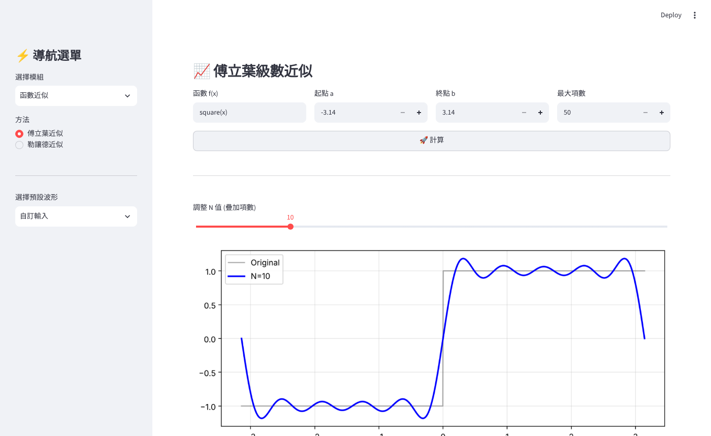
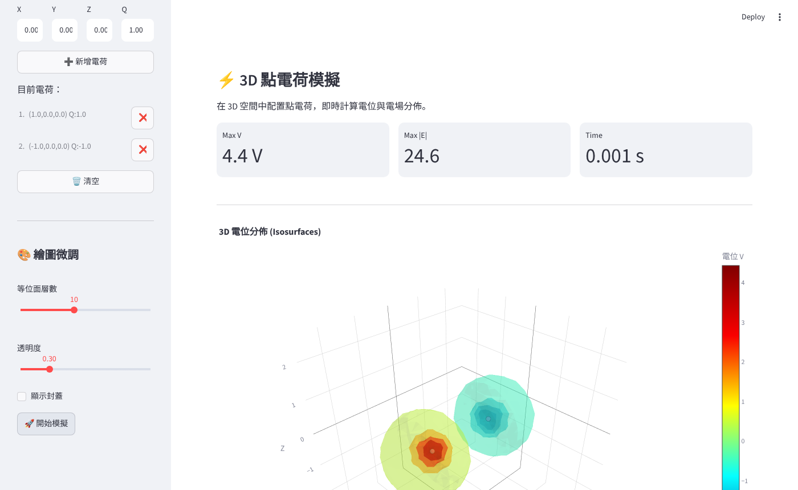

# 電磁學生成小教室 · Electromagnetics Visualization Hub

[English](README.md) | **繁體中文**

用 [Streamlit](https://streamlit.io/) 寫的大學電磁學互動教具：輸入函數或邊界條件，就能在瀏覽器裡看到級數近似、電位與電場分佈。內容對應電磁學入門課（Griffiths 第 2–3 章）的級數展開與 Laplace 方程：傅立葉級數、勒讓德級數、2D 與 3D 的 Laplace 方程，以及點電荷與連續電荷分佈的電位和電場。

整個程式只有一個檔案 `app.py`，介面是繁體中文。



## 目錄

- [適合誰用](#適合誰用)
- [功能一覽](#功能一覽)
- [需求與安裝](#需求與安裝)
- [使用說明](#使用說明)
  - [導覽與執行按鈕](#導覽與執行按鈕)
  - [函數的寫法](#函數的寫法)
  - [傅立葉級數](#傅立葉級數傅立葉近似)
  - [勒讓德級數](#勒讓德級數勒讓德近似)
  - [2D 笛卡爾：正方形內的 Laplace 方程](#2d-笛卡爾正方形內的-laplace-方程)
  - [2D 球座標：極座標切面上的電位](#2d-球座標極座標切面上的電位)
  - [2D 點電荷](#2d-點電荷)
  - [3D 笛卡爾：立方體內的 Laplace 方程](#3d-笛卡爾立方體內的-laplace-方程)
  - [3D 球座標：球內的連續電荷](#3d-球座標球內的連續電荷)
  - [3D 點電荷](#3d-點電荷)
  - [3D 顯示模式](#3d-顯示模式)
- [運作方式](#運作方式)
- [專案結構](#專案結構)
- [測試](#測試)
- [疑難排解與常見問題](#疑難排解與常見問題)
- [限制](#限制)
- [沿革](#沿革)
- [授權](#授權)

## 適合誰用

- 正在修電磁學的學生：想親眼看傅立葉或勒讓德級數怎麼收斂、邊界條件怎麼決定 Laplace 方程的解、電偶極的 3D 電場長什麼樣子。
- 老師與助教：上課時現場示範。

所有物理量都用無因次單位計算，庫倫常數取 $k = 1$；指標上的「V」「V/m」只是標示。

## 功能一覽

| 模組（側欄） | 頁面 | 計算內容 | 方法 |
|---|---|---|---|
| 函數近似 | 傅立葉近似 | 任意 $f(x)$ 在 $[a, b]$ 的傅立葉級數，用滑桿調整項數 | 數值積分求係數（`scipy.integrate.quad`） |
| | 勒讓德近似 | $f(x)$ 在 $[-1, 1]$ 的勒讓德級數，同時畫直角座標與極座標圖 | `quad` 求係數，$P_n$ 用 `scipy.special.eval_legendre` |
| 電位+電場模擬 (2D) | 笛卡爾 | 正方形四邊給定電位的 $\nabla^2 V = 0$ | 有限差分（Jacobi 迭代）**或** SymPy 分離變數解析解 |
| | 球座標 | 自行輸入的 $V(r,\theta)$ 及其電場 $\mathbf E = -\nabla V$，畫在平面上 | SymPy 符號微分 |
| | 點電荷 | 多個點電荷的電位圖與電力線 | 直接疊加 |
| 電位+電場模擬 (3D) | 笛卡爾 | 單位立方體六面給定電位的 $\nabla^2 V = 0$ | 3D 有限差分（Jacobi 迭代） |
| | 球座標 | 球內連續電荷密度 $\rho(r,\theta,\phi)$ 產生的場 | 把球切成 1152 個體積元，當成點電荷疊加 |
| | 點電荷 | 在 3D 空間任意放置點電荷的電位與電場 | 直接疊加 |

每個 3D 頁面都能顯示等位面、電場方向錐，或描出的電力線（Plotly，可旋轉）。傅立葉與勒讓德頁面可以下載 PNG 圖與係數表。



## 需求與安裝

- Python 3（附的開發容器用 Python 3.11）。
- `requirements.txt` 列的套件：`streamlit>=1.50`、`numpy`、`scipy`、`matplotlib`、`pandas`、`sympy`、`plotly`。

```bash
git clone https://github.com/Celivem/Electromagnetics-Visualization-Hub.git
cd Electromagnetics-Visualization-Hub
python -m venv .venv
# Windows：.venv\Scripts\activate    macOS/Linux：source .venv/bin/activate
pip install -r requirements.txt
streamlit run app.py
```

Streamlit 會印出本機網址（預設 `http://localhost:8501`），用瀏覽器開啟即可。

**GitHub Codespaces。** repo 附有 `.devcontainer/devcontainer.json`。在 Codespace 開啟時會自動安裝 `requirements.txt`、執行 `streamlit run app.py`，並把 8501 埠轉到預覽分頁。

**Streamlit Community Cloud。** 新增 app 時指向這個 repo，主程式選 `app.py`。公開部署前請先看[疑難排解](#疑難排解與常見問題)中關於函數求值的說明。

## 使用說明

### 導覽與執行按鈕

側欄標題是 **⚡ 導航選單**，在 **選擇模組** 選擇：

| 模組 | 子頁面（側欄單選） |
|---|---|
| 首頁 | 歡迎訊息 |
| 函數近似 | 傅立葉近似、勒讓德近似 |
| 電位+電場模擬 (2D) | 笛卡爾、球座標、點電荷 |
| 電位+電場模擬 (3D) | 笛卡爾、球座標、點電荷 |

按下該頁的執行按鈕（**🚀 計算**、**🚀 運算** 或 **🚀 開始模擬**）之前不會做任何計算。結果會存在工作階段裡，所以：

- **顯示設定**（級數頁的 N 滑桿、顯示模式、透明度、等位面層數、箭頭大小、流線數量等）會立刻套用到已存的結果。
- **物理參數**（函數、邊界電位、網格大小、電荷、迭代上限）要再按一次執行按鈕才會生效。

較重的計算另外用 `st.cache_data` 快取，相同輸入再算一次會直接回傳。

### 函數的寫法

不同頁面用兩種不同的解析方式：

| 頁面 | 解析方式 | 語法 | 範例 |
|---|---|---|---|
| 傅立葉、勒讓德 | Python `eval`，搭配 NumPy 函數 | Python 語法：次方用 `**`，乘法一律寫 `*` | `x**2`、`sin(pi*x)`、`exp(-x)`、`square(x)`、`where(x > 0, 1, 0)` |
| 2D 笛卡爾（解析解）、2D 球座標、3D 球座標（自訂 $\rho$） | SymPy `parse_expr`，支援省略乘號，`^` 視為次方 | 一般數學寫法 | `x^2`、`sin(pi x)`、`e^-x`、`k*cos(theta)/r^2` |

傅立葉與勒讓德頁面可用的名稱：`sin`、`cos`、`tan`、`exp`、`log`、`sqrt`、`abs`、`sign`、`sinh`、`cosh`、`arcsin`、`arccos`、`arctan`、`maximum`、`minimum`、`where`、`heaviside`、`gamma`、`pi`、`square` 與 `sawtooth`（來自 `scipy.signal`）、`legendre(n, x)`（即 $P_n(x)$），以及模組 `np`、`signal`、`special`。

在 SymPy 頁面，`e` 代表自然對數的底，`pi` 代表 $\pi$；變數是 `x`、`y`（2D 笛卡爾）、`r`、`theta`、`k`（2D 球座標）以及 `r`、`theta`、`phi`（3D 球座標）。`sin`、`cos`、`exp`、`sqrt` 等常見 SymPy 函數都能用。

### 傅立葉級數（傅立葉近似）

設 $f(x)$ 定義在 $[a, b]$，週期 $L = b - a$，$\omega = 2\pi/L$。頁面用 `scipy.integrate.quad` 算出 $n = 0, 1, \dots, N_\text{max}$ 的

$$A_n = \frac{2}{L}\int_a^b f(x)\cos(n\omega x)\,dx,\qquad B_n = \frac{2}{L}\int_a^b f(x)\sin(n\omega x)\,dx,$$

再在 1000 個點上畫出部分和

$$S_N(x) = \frac{A_0}{2} + \sum_{n=1}^{N}\bigl[A_n\cos(n\omega x) + B_n\sin(n\omega x)\bigr]$$

與原函數（灰線）比較。增加 $N$ 時觀察不連續點附近的過衝，就是 Gibbs 現象。

| 控制項 | 標籤 | 預設值 |
|---|---|---|
| 函數 | 函數 f(x) | `square(x)` |
| 區間起點／終點 | 起點 a／終點 b | −3.1415／3.1415 |
| 係數個數 | 最大項數 | 50 |
| 預設波形（側欄） | 選擇預設波形 | 自訂輸入 |
| 部分和的項數 | 調整 N 值（計算後出現的滑桿） | min(10, N_max) |

預設波形：方波 `square(x)`、多週期方波 `square(3 * x)`、鋸齒波 `sawtooth(x)`、三角波 `sawtooth(x, 0.5)`、全波整流 `abs(sin(x))`、半波整流 `maximum(sin(x), 0)`、脈衝波 `square(x, duty=0.2)`。

輸出：圖、**📥 下載圖表**（PNG，150 dpi，`fourier.png`）、**📥 下載係數**（`coeffs.csv`，欄位 `n`、`An`、`Bn`，以 Tab 分隔），以及可展開的「查看係數表」。

### 勒讓德級數（勒讓德近似）

在 $[-1, 1]$ 上，係數為

$$c_n = \frac{2n+1}{2}\int_{-1}^{1} f(x)\,P_n(x)\,dx,\qquad f(x) \approx \sum_{n=0}^{N} c_n P_n(x).$$

在 400 個點上並排畫兩張圖：

- **直角座標**：目標函數（虛線）與近似，橫軸標為 $x = \cos\theta$。
- **極座標**：$\theta \in [0, 2\pi]$ 的 $|f(\cos\theta)|$ 與近似的絕對值，也就是球座標 Laplace 方程對應解的角向分佈。

| 控制項 | 標籤 | 預設值 |
|---|---|---|
| 函數 | 輸入 f(x) | `where(x > 0, 1, 0)` |
| 最高階數 | 最大階數 | 20 |
| 預設波形（側欄） | 選擇波形 | 自訂輸入 |
| 疊加的階數 | 疊加階數（滑桿） | 全部 |

預設波形：方波 `where(x > 0, 1, 0)`、三角波 `where(x > 0, x, 0)`、絕對值 `abs(x)`、多週期方波 `sign(sin(4 * pi * x))`、波包 `sin(15 * x) * exp(-5 * x**2)`、全波整流 `abs(sin(3 * pi * x))`、AM 調變 `(1 + 0.5 * cos(10 * x)) * cos(50 * x)`、偶極子 `x`、四極子 `3*x**2 - 1`。

下載：`legendre.png` 與 `coeffs.csv`（欄位 `n`、`cn`，以 Tab 分隔）。

### 2D 笛卡爾：正方形內的 Laplace 方程

用 **模式** 單選鈕切換。

**數值解 (FDM)。** 正方形是 40 × 40 的網格。每一邊有電位輸入（`上`／`下`／`左`／`右` V；預設上邊 10，其餘 0）與 **接地/無窮** 勾選框。內部用五點差分的 Jacobi 迭代更新

$$V_{i,j} \leftarrow \tfrac14\bigl(V_{i+1,j} + V_{i-1,j} + V_{i,j+1} + V_{i,j-1}\bigr),$$

每次掃描後重設固定的邊，掃描次數由 **迭代** 決定（500–5000，預設 2000）。這裡沒有收斂判斷，進度條顯示掃描進度。

勾選某邊的 **接地/無窮** 時，這一邊就**不**固定電位，而是把網格往這一邊多延伸 120 格（正方形邊長的三倍），最外緣設為 $V = 0$。如此解會平順地延伸到一個遠處電位趨近零的開放區域。畫面只顯示原本的 40 × 40 正方形，以熱圖（`jet` 色階）畫在單位正方形上。

**解析解。** 用 SymPy 語法輸入四個邊界函數 $V(x,1)$、$V(x,0)$、$V(0,y)$、$V(1,y)$（留空或 `0` 表示該邊為零）。每個非零的邊貢獻一組分離變數級數，以上邊為例：

$$V_\text{上}(x,y) = \sum_{n=1}^{\infty} A_n \sin(n\pi x)\,\frac{\sinh(n\pi y)}{\sinh(n\pi)},\qquad A_n = 2\int_0^1 V(x,1)\sin(n\pi x)\,dx,$$

下、左、右邊分別改用 $\sinh(n\pi(1-y))$、$\sinh(n\pi(1-x))$、$\sinh(n\pi x)$。SymPy 以一般的 $n$ 做符號積分求出 $A_n$，頁面用 LaTeX 印出級數的一般項，接著在 50 × 50 網格上把 $n = 1, \dots, 20$ 的數值加總並畫出熱圖。

### 2D 球座標：極座標切面上的電位

在側欄 **輸入 V(r, theta)** 輸入任意電位 $V(r, \theta)$，或在 **選擇模型** 挑預設：

| 預設 | 式子 |
|---|---|
| 點電荷 | `k/r` |
| 電偶極（預設） | `k*cos(theta)/r^2` |
| 電四極 | `k*(3*cos(theta)**2 - 1)/r^3` |
| 均勻電場 | `-k*r*cos(theta)` |
| 複雜組合 | `k/r + r*cos(theta)` |

SymPy 算出

$$E_r = -\frac{\partial V}{\partial r},\qquad E_\theta = -\frac{1}{r}\frac{\partial V}{\partial \theta},$$

並用 LaTeX 顯示 $V$ 與 $\mathbf E$。式子取 $k = 1$，在圖面的正方形網格上求值：$r = \sqrt{x^2 + y^2}$，$\theta$ 從圖的 $+x$ 軸量起（`atan2(y, x)`），$r$ 最小取 $10^{-3}$。圖是 $V$ 的填色等高線圖（50 層），可加上由 $\mathbf E$ 換成直角分量後畫的電力線。

控制項：**範圍**（圖的半寬，1–10，預設 5）、**網格解析度**（50–200，預設 100）、**顯示流線**（預設開）。

### 2D 點電荷

在正方形 $[-5, 5]^2$ 上，點電荷的電位為

$$V(x,y) = \sum_i \frac{q_i}{r_i + 10^{-9}},$$

畫成填色等高線圖（50 層，紅藍色階）加等位線，可選擇加上電力線（由 $-\nabla V$ 求得），電荷以 + 或 − 標出。

側欄 **🔋 電荷控制** 用 **電荷量 (q)**、**X 座標**／**Y 座標**（−5 到 5，間距 0.5）與 **➕ 加入電荷** 新增電荷，**🗑️ 清除所有** 移除全部。預設是一組電偶極：$(-2, 0)$ 放 $+1$、$(2, 0)$ 放 $-1$。其他控制項：**顯示流線**、**網格解析度**（50–200，預設 100）。

### 3D 笛卡爾：立方體內的 Laplace 方程

單位立方體切成 $N \times N \times N$ 的網格（**網格點數 (N)**，10–60，預設 30），六個面固定電位（**設定邊界電位**）：

| 面 | 標籤 | 預設值 |
|---|---|---|
| $z = 1$ | 頂面 | 100 |
| $z = 0$ | 底面 | −100 |
| $y = 1$ | 後面 | 0 |
| $y = 0$ | 前面 | 0 |
| $x = 1$ | 右面 | 0 |
| $x = 0$ | 左面 | 0 |

內部用六點平均的 Jacobi 迭代鬆弛

$$V_{i,j,k} \leftarrow \tfrac16\bigl(V_{i\pm1,j,k} + V_{i,j\pm1,k} + V_{i,j,k\pm1}\bigr)$$

（六個相鄰點相加），最多 **最大迭代** 次（預設 3000）。每 200 次掃描比較一次相鄰兩次掃描間的最大變化量與 **精度**（1e-2、1e-3、1e-4 或 1e-5，預設 1e-4），小於精度就停止。電場 $\mathbf E = -\nabla V$ 用 `numpy.gradient` 計算，網格間距 $h = 1/(N-1)$。

顯示的指標：Max V、Max |E|、網格點數 $N^3$、計算時間（滑鼠移到上面可看停止時的迭代次數）。**隱藏邊界層**（預設開）在圖中隱藏最外層網格點，避免固定的邊界值主導畫面；指標一律用完整網格計算。

### 3D 球座標：球內的連續電荷

半徑 $R$（**球體半徑 (R)**，0.5–2.0，預設 1.2）的球內填入 **電荷分佈模型** 選定的電荷密度：

| 選項 | $\rho(r,\theta,\phi)$ |
|---|---|
| Uniform（均勻） | $1$ |
| Decaying (1/r) | $1/r$ |
| Orbital (p-like) | $2\lvert\cos\theta\rvert$ |
| Custom（自訂） | 以 $r$、$\theta$、$\phi$ 寫的 SymPy 式子（預設 `r * cos(theta)`） |

球被切成 $8 \times 12 \times 12 = 1152$ 個體積元（$r$、$\theta$、$\phi$ 都取中點）。每個體積元在中心帶電量 $dq = \rho\, r^2 \sin\theta\, \Delta r\, \Delta\theta\, \Delta\phi$，3D 網格上的電位與電場就是這些點電荷的疊加（$k = 1$），距離小於 0.15 時以 0.15 計。空間範圍是立方體 $[-L, L]^3$，**空間範圍 (±)** $L$ 為 1–4（預設 2），**網格解析度** 每軸 10–30 點（預設 18）。指標：微分單元數、Max |E|、計算時間。

### 3D 點電荷

在 3D 空間任意放置點電荷（側欄 **🔋 電荷管理**：X、Y、Z、Q 與 **➕ 新增電荷**；清單中每個電荷有 **❌** 刪除鈕，**🗑️ 清空** 移除全部）。預設是一組電偶極：$(1, 0, 0)$ 放 $+1$、$(-1, 0, 0)$ 放 $-1$。電位與電場為

$$V = \sum_i \frac{q_i}{r_i},\qquad \mathbf E = \sum_i \frac{q_i\,\mathbf r_i}{r_i^3},$$

計算範圍是立方體 $[-L, L]^3$（**空間範圍 (±)**，1.0–5.0，預設 2.5），**網格解析度** 每軸 10–40 點（預設 20）；距離小於 0.2 時以 0.2 計，避免奇異點。每種顯示模式都會把電荷畫在圖上。指標：Max |V|、Max |E|、計算時間。

### 3D 顯示模式

三個 3D 頁面共用 **選擇視覺化模式**：

| 模式 | 畫面 | 控制項（範圍，預設） |
|---|---|---|
| 電位分佈 (Potential) | $V$ 從最小值到最大值的 Plotly 等位面 | 等位面層數 3–20（10）、透明度 0.1–1.0（0.3）、顯示封蓋（關） |
| 電場向量 (Vectors) | 固定大小、指向 $\mathbf E$ 的錐形箭頭；顏色代表 $\log_{10}\lvert\mathbf E\rvert$，在第 5 到第 95 百分位之間分 20 級 | 箭頭大小、採樣間隔（每隔幾個網格點畫一個） |
| 電場流線 (Field Lines) | 從隨機起點描出的電力線，顏色代表 $V$（第 5 到第 95 百分位） | 流線數量 10–50（20）、線條粗細 2–10（5）、線條透明度 0.1–1.0（0.8） |

各頁的箭頭大小與採樣間隔範圍：笛卡爾 0.05–0.2（0.1）與 1–5（2）；點電荷 0.3–1.0（0.5）與 1–3（1）；球座標 0.05–0.5（0.15）與 1–3（1）。

電力線的起點隨機均勻分佈在盒子中央 80 % 的範圍內。每條線從起點往前、往後沿單位向量 $\mathbf E/\lvert\mathbf E\rvert$ 以固定步長（盒子寬度的 1 %）前進，每個方向最多 200 步；網格上的電場用三線性內插取值（`scipy.interpolate.RegularGridInterpolator`）。離開盒子或場強低於 $10^{-9}$ 時停止，少於三個點的線捨棄。

## 運作方式

`app.py` 分成六個編號段落：

| 段落 | 內容 |
|---|---|
| 1. 頁面設定 | `st.set_page_config`、CSS、session state 預設值（電荷、計算結果暫存） |
| 2. 2D 核心函數 | `get_safe_math_scope`、`eval_func`（Python 語法的函數）、`smart_parse`（SymPy 解析）、`calculate_fourier_coefficients`、`calculate_legendre_coefficients`、`calculate_point_charge_potential`、`plot_heatmap` |
| 3. 3D 核心函數 | `calculate_3d_physics`（3D Jacobi 解法）、`calculate_point_charge_field_3d`、`calculate_continuous_spherical`、`calculate_streamlines`，以及 Plotly 繪圖函數 `create_potential_figure`、`create_field_figure_log`、`create_streamline_figure` |
| 4. 2D 頁面 | `render_fourier_page`、`render_legendre_page`、`render_potential_point_charge`、`render_laplace_cartesian_2d`（2D FDM 迴圈與 SymPy 解析解在這裡）、`render_potential_spherical_2d` |
| 5. 3D 頁面 | `render_3d_cartesian`、`render_3d_point_charge`、`render_3d_spherical` |
| 6. 導覽 | 側欄模組選單，分派到各頁面函數 |

每一頁的資料流程：介面元件 → （執行按鈕）→ 以 `@st.cache_data` 快取的計算函數 → 結果存進 `st.session_state['res_…']` → 繪圖程式讀取已存結果與目前的顯示設定。級數頁與 2D 頁用 Matplotlib 繪圖，3D 頁用 Plotly。

## 專案結構

```
.
├── app.py                     # 整個 Streamlit 程式
├── requirements.txt           # Python 套件
├── .devcontainer/
│   └── devcontainer.json      # GitHub Codespaces：Python 3.11，自動在 8501 埠啟動
├── docs/
│   ├── fourier.png            # 截圖：傅立葉頁面
│   └── 3d_point_charge.png    # 截圖：3D 點電荷
├── .gitignore
├── README.md                  # 英文說明
└── README.zh-TW.md            # 本檔（繁體中文）
```

## 測試

目前沒有自動化測試。修改後請執行 `streamlit run app.py`，實際操作受影響的頁面。

## 疑難排解與常見問題

**傅立葉或勒讓德的圖是空的，或係數是 `nan`。** 這兩頁把函數當 Python 程式碼求值，`x^2`（在 Python 是位元 XOR）、`sin(pi x)`、`2x` 都不成立，請寫成 `x**2`、`sin(pi*x)`、`2*x`。`x^2` 這類數學寫法只在[函數的寫法](#函數的寫法)列出的 SymPy 頁面有效。

**3D 球座標頁的自訂 $\rho$ 看起來和均勻球一樣。** 自訂式子無法解析時，程式不會報錯，而是直接改用 $\rho = 1$；式子能解析但在某些點求值失敗時，那些體積元的 $\rho$ 取 0。請檢查 `r`、`theta`、`phi` 與函數名稱的拼法。

**改了參數卻沒有變化。** 物理參數要再按一次執行按鈕才會生效，見[導覽與執行按鈕](#導覽與執行按鈕)。

**3D 笛卡爾的 Max |E| 非常大。** 電位不同的兩個面相接處（以預設值來說，是 +100、−100 的面與接地側面相交的邊），電位在一個網格內跳變，有限差分的梯度在那裡最大。保持 **隱藏邊界層** 開啟，圖中就不會出現這些點。

**改了流線數量後，流線的樣子不同。** 起點是隨機取的。輸入完全相同時會沿用快取結果，畫面不會變；任何輸入改變就會重新取點。

**3D 頁面在高解析度時很慢。** 計算量隨網格點數（$N^3$）增加。3D 笛卡爾在較細的網格上也需要更多次迭代才會收斂；如果在達到精度前就停在迭代上限，請提高 **最大迭代**。

**下載的 `coeffs.csv` 打開後只有一欄。** 檔案以 Tab 分隔，匯入時請選 Tab 作為分隔符號。

**可以公開部署嗎？** 傅立葉與勒讓德頁面把輸入字串交給 Python `eval()`，停用了內建函數，只開放上面列出的數學名稱。這能擋住一般的誤用，但不是安全沙箱；部署到不受信任的人也能輸入的地方時請特別小心。

## 限制

- 無因次單位，$k = 1$；不使用 $\varepsilon_0$ 等 SI 常數。
- 2D 有限差分固定用 40 × 40 網格、固定掃描次數，沒有收斂判斷；2D 解析解的級數加到 $n = 20$。
- 點電荷的奇異點以截斷距離（3D 為 0.2、連續球為 0.15）或加上 $10^{-9}$（2D）處理，電荷旁邊的數值不具物理意義。
- 連續球固定切成 1152 個體積元。
- 2D 球座標頁只顯示一個平面，$\theta$ 從圖的 $+x$ 軸量起；它不解邊界值問題，而是畫出你輸入的電位。
- 2D 點電荷頁的電荷只能一次全部清除。
- 介面只有繁體中文。

## 沿革

本 repo 整併了先前分開的三個小工具（傅立葉、勒讓德、Laplace），它們的功能都已包含在 `app.py` 中：

- `Celivem/useless-toolbox`（傅立葉級數）
- `Celivem/Legendre-Series`
- `Celivem/laplace-solving`

舊版 `app V1.py`、`app.V1.2.py` 保留在 git 歷史中。

## 授權

以 [MIT License](LICENSE) 釋出。
